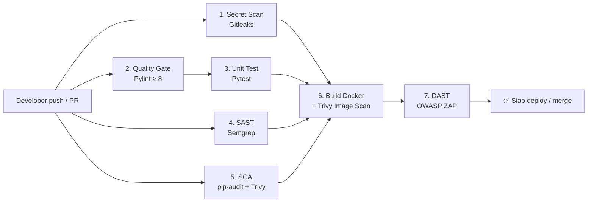

# DevSecOps Pipeline – PBL RKS532 Keamanan Pengembangan Perangkat Lunak

Repo ini menunjukkan penerapan **DevSecOps**: keamanan dimasukkan ke setiap tahap CI/CD (*shift-left security*) menggunakan **GitHub Actions**. Setiap `push` atau `pull request` ke `main` otomatis menjalankan 7 tahap pemeriksaan. Kalau ada temuan kritis, pipeline **gagal** sehingga kode tidak bisa di-merge.

## Alur Pipeline



| # | Tahap | Tool | Materi | Yang dicegah |
|---|-------|------|--------|--------------|
| 1 | Secret Scanning | Gitleaks | T13 | Password/API key/token ikut ter-commit |
| 2 | Code Quality Gate | Pylint (`--fail-under=8`) | P11 | Kode berkualitas buruk masuk ke main |
| 3 | Unit & Security Test | Pytest | T08 | Regresi fungsi, bypass login (SQLi), header hilang |
| 4 | SAST | Semgrep (`p/python`, `p/owasp-top-ten`) | P04, T14 | SQL injection, command injection, XSS, kode tidak aman |
| 5 | SCA | pip-audit + Trivy FS | T12 | Library pihak ketiga dengan CVE |
| 6 | Container Security | Docker + Trivy Image | P07 | Base image / OS package rentan |
| 7 | DAST | OWASP ZAP Baseline | P08 | Kerentanan runtime: header, cookie, misconfig |

## Gambaran Fase SSDLC

- **Requirement & Design (P01, P02):** threat model STRIDE ada di [`SECURITY.md`](SECURITY.md)
- **Implementation (P03):** secure coding di `app/app.py`, yaitu parameterized query, validasi input allow-list, password hashing, secret dari env, security headers, dan pesan error generik
- **Verification:** pipeline otomatis di `.github/workflows/devsecops.yml`
- **Release:** container berjalan sebagai **non-root user** dengan healthcheck
- **Governance:** branch protection, yaitu `main` hanya bisa di-merge kalau semua job lulus

## Menjalankan Lokal

```bash
pip install -r requirements.txt -r requirements-dev.txt
PYTHONPATH=. pytest -v
pylint app tests --fail-under=8
semgrep scan --config p/python
docker build -t devsecops-app . && docker run -p 5000:5000 devsecops-app
```

## Branch Protection (P11)

Settings → Branches → Add rule `main` → centang **Require a pull request before merging** dan **Require status checks to pass** → pilih semua job pipeline.

## Demo "Pipeline Menangkap Kerentanan"

Buat branch baru lalu ubah query login menjadi rentan, contoh:
```python
db.execute(f"SELECT * FROM users WHERE username = '{username}'")
```
Setelah itu buka PR. **Semgrep** akan menandai SQL injection, pipeline jadi merah, dan PR tidak bisa di-merge. Ini bukti bahwa keamanan berjalan otomatis.
